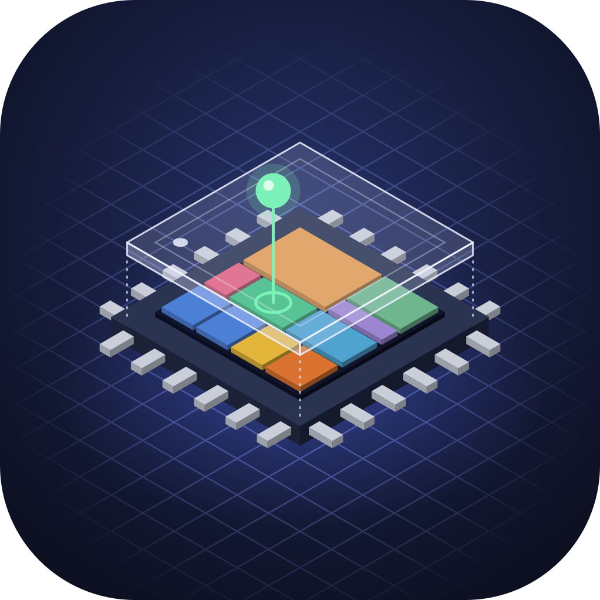
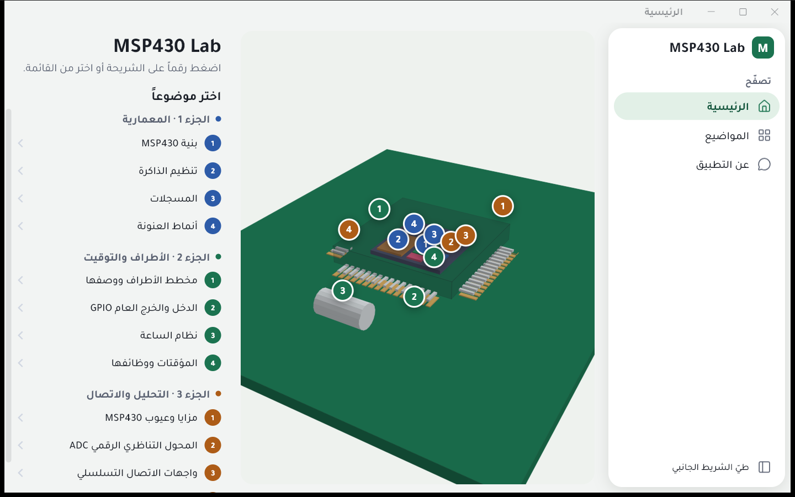
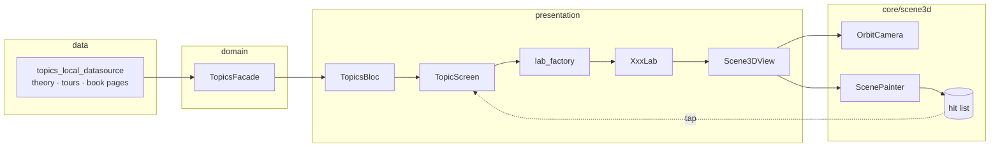

<div align="center">






**An interactive 3D explainer for the TI MSP430F149 microcontroller.**<br/>
Twelve topics, from the CPU's buses to interrupts. Each one has a 3D scene you can turn, a guided tour and controls to try things yourself.

[Screens](#-screens) ·
[Topics](#-the-twelve-topics) ·
[Controls](#-controls) ·
[How it works](#-how-it-works) ·
[Run it](#-run-it) ·
[Windows installer](#-windows-installer) ·
[Project layout](#-project-layout)

</div>

---

## Highlights

<table>
<tr>
<td width="33%" valign="top">

### Real 3D, no engine
The whole scene is drawn with Flutter's `CustomPainter`. There is no game engine and no WebGL. You can drag it, zoom with the wheel, a pinch or a touchpad, and tap any part to see its name.

</td>
<td width="33%" valign="top">

### Guided tours
Press <kbd>Space</kbd> and the topic explains itself. The camera flies to each part and the scene acts it out, one step at a time.

</td>
<td width="33%" valign="top">

### Try it yourself
Change P1OUT, turn the ADC's potentiometer, set the PWM duty or send a byte over UART, SPI or I²C, then watch the chip react.

</td>
</tr>
<tr>
<td valign="top">

### From the book
The text follows Chris Nagy, *Embedded Systems Design using the TI MSP430 Series* (Newnes, 2003) and the F149 datasheet. Each topic gives its page number.

</td>
<td valign="top">

### One layout, every screen
Phones get a list. Tablets get a rail. Windows gets a sidebar and a custom title bar. Resizing the window changes the layout live.

</td>
<td valign="top">

### Fully offline
All content ships inside the app. There is no network, no account and nothing that can fail on a lab PC.

</td>
</tr>
</table>

---

## Screens

<div align="center">

<br/><sub><b>Home</b> on Windows. Tap a numbered dot and the camera glides to that part, then opens its topic.</sub>
</div>

---

## The twelve topics



<details>
<summary><b>What each scene shows</b></summary>

| # | Topic | The 3D scene |
| :-: | --- | --- |
| 1.1 | Architecture | The die and its twelve blocks, joined by the MAB and MDB buses |
| 1.2 | Memory map | The address space as a tower, 0x0000 at the bottom |
| 1.3 | Registers | R0–R15 as a 16 × 16 grid of bits, running a loop that adds 5 + 4 + 3 + 2 + 1 |
| 1.4 | Addressing modes | Where the operand comes from, in each of the seven modes |
| 2.1 | Pinout | The 64 pins, coloured by port |
| 2.2 | GPIO | An LED on P1.0 and a button on P1.1, driven by P1DIR, P1OUT and P1IN |
| 2.3 | Clock system | Three sources, three clocks, and the low-power modes that stop them |
| 2.4 | Timer_A | Counting up to TACCR0 with the output reset at TACCR1 (OUTMOD 7); a motor follows the duty cycle |
| 3.1 | Pros & cons | Six green balls (advantages) and five red ones (disadvantages) around the chip |
| 3.2 | ADC12 | A potentiometer on A0; the 12-bit result fills a column to 4095 at VREF+ |
| 3.3 | Serial | A byte sent bit by bit over UART, SPI or I²C wires |
| 3.4 | Interrupts | A press wakes the CPU. PC and SR go onto the stack, the vector table gives the routine, RETI restores them and the CPU sleeps again |

</details>

---

## Controls



---

## How it works





- **`OrbitCamera`**: orbits a target with angles θ and φ and a radius. It flies smoothly between poses and keeps zoom between 0.35× and 2.4× of home.
- **`ScenePainter`**: projects each shape, sorts them back to front and paints them. It also stores what it drew, so a tap can find the part under it.
- **Labs**: one per topic (`presentation/labs/*_lab.dart`). Each rebuilds its scene every tick and exposes *try-it* controls and named tour steps.

---

## Run it

```bash
flutter pub get
flutter run -d windows     # or an Android phone / tablet
```

> [!TIP]
> On Windows, the first build is slower because it compiles the C++ runner. Builds after that are quick.

---

## Windows installer



```bash
dart run tool/build_windows_installer.dart              # build + package
dart run tool/build_windows_installer.dart --skip-build # reuse the last build
```

This needs **[Inno Setup 6](https://jrsoftware.org/isinfo.php)** (free). The result is `build/installer/msp430_lab-<version>-setup.exe`. It installs per user with no admin prompt, adds a Start-menu entry and an optional desktop shortcut, and comes with an uninstaller.

<details>
<summary><b>Releasing a new version</b></summary>

1. Bump `version:` in `pubspec.yaml`, for example `1.0.1+2`.
2. Run the command above.
3. Share the new `setup.exe`. Running it over an old install updates that install in place, because the `AppId` stays the same.

> [!NOTE]
> The installer is not code-signed, so Windows SmartScreen shows *"unknown publisher"* the first time. Click **More info → Run anyway**.

</details>

---

## Project layout

<details>
<summary><b>Show the tree</b></summary>

```text
lib/
├── core/
│   ├── scene3d/          orbit camera, painter, scene builder, vectors
│   ├── layout/           window size classes, scroll behaviour
│   ├── window/           custom title bar, window placement
│   ├── shortcuts/        keyboard shortcuts, menu bar
│   ├── router/ theme/ config/ injection/ …
├── features/
│   ├── home/             the chip with a dot per topic
│   ├── topics/
│   │   ├── data/         the twelve topics, theory and tours
│   │   └── presentation/
│   │       ├── labs/     one 3D lab per topic
│   │       └── ui/       topic screen, tour bar, controls
│   ├── about/  root/  splash/
tool/
├── build_windows_installer.dart   setup.exe via Inno Setup
├── gen_readme_svgs.py             redraws the images in this README
└── generate_feature.dart  generate_app_strings.dart  widget_catalog.dart
```

More detail: [`docs/PROJECT_MAP.md`](docs/PROJECT_MAP.md) · [`docs/RESPONSIVE.md`](docs/RESPONSIVE.md) · [`docs/DESKTOP_SETUP.md`](docs/DESKTOP_SETUP.md) · [`docs/CODE_STYLE.md`](docs/CODE_STYLE.md)

</details>

---

## Built with

| | |
| --- | --- |
| **UI** | Flutter · Material 3 · Tajawal font · custom `CustomPainter` 3D |
| **State** | `flutter_bloc` · `freezed` · `get_it` / `injectable` |
| **Navigation** | `go_router` |
| **Language** | `easy_localization`, Arabic first (RTL) |
| **Desktop** | `window_manager` · `windows_single_instance` · Inno Setup |

<div align="center">
<br/>
<sub>The images in this README are animated SVGs drawn by <code>tool/gen_readme_svgs.py</code>. Run <code>python tool/gen_readme_svgs.py</code> to redraw them.</sub>
</div>
